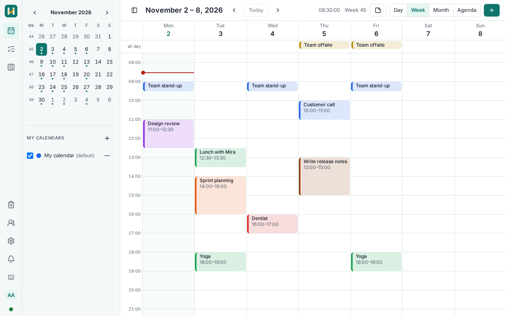
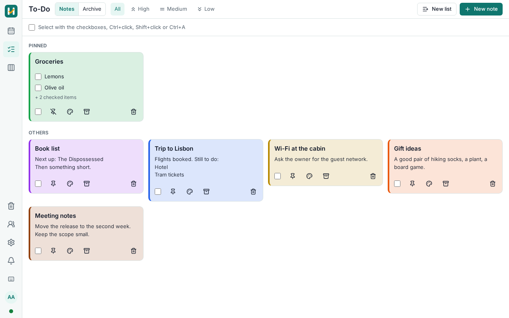
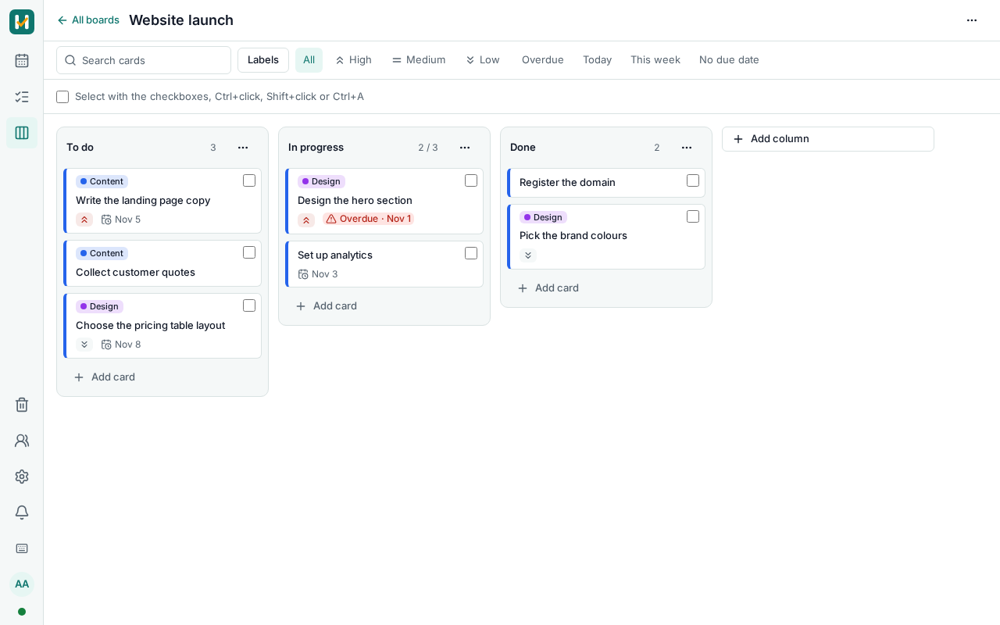
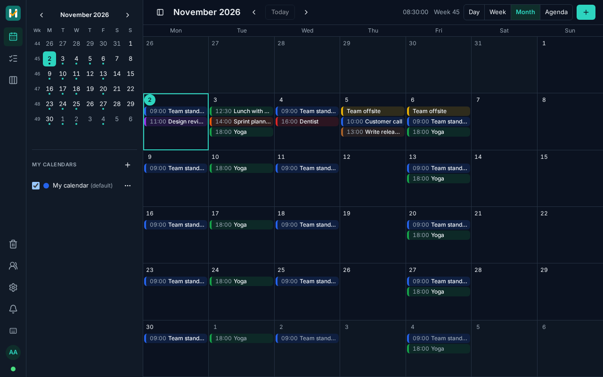
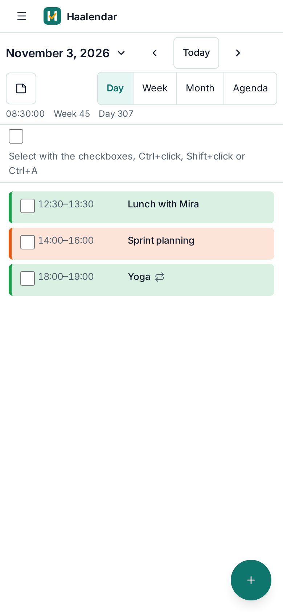

<!-- +++===+++ 2026-11-08 — Hasan Alizada — HAAL-152. The README of the product: what it is, how to install and run it. -->

<p align="center"></p>

<p align="center"><strong>A self-hosted calendar, to-do list and kanban board in one app that keeps working offline.</strong></p>

<p align="center">
  <a href="https://github.com/hasanfalizada/Haalendar/actions/workflows/ci.yml"></a>
  <a href="LICENSE"></a>
</p>

> **Status:** version 1.0 is in its final preparation and has not been released yet, so the image tag `1.0.0` used below
> does not exist yet. Until then you can run Haalendar from the sources: see the [development guide](DEVELOPMENT.md).

Your plans stay on your own server. Haalendar runs with Docker Compose on x86_64 or arm64, serves several users with
their data kept apart, and opens and works on a phone or laptop without a connection, syncing when it comes back.



| To-Do | Kanban |
|---|---|
|  |  |

| Dark theme | On a phone |
|---|---|
|  |  |

## Features

**Calendar**

- Day, week, month and agenda views, with ISO week numbers and an optional Week A/B label.
- Repeating events: every N days, weeks, months or years, chosen weekdays, the Nth or last weekday, until a date or N
  times. Edit or delete one occurrence, this and the following ones, or all of them.
- Drag and drop to reschedule, several calendars, colours, priorities, overdue counter.
- Reminders in the app and as Web Push, even with the browser closed.
- ICS import and export.

**To-Do**

- Notes with Markdown and checklists; pin, colour, priority, archive and reminders.

**Kanban**

- Boards, columns with work-in-progress limits, cards with due dates, labels, checklists and assignees.
- Move cards by drag and drop, by touch or with the keyboard; filter by text, label, priority and due date.

**Across the app**

- **Offline first:** an installable web app (PWA) that keeps your changes locally, syncs them when back online, and lets
  you settle a conflict field by field. Changes reach your other devices live.
- **Connected:** link events, notes and cards to each other, and drop a note or a card on the week to block time for it.
- **Nothing is lost:** a trash with restore, undo and redo, a history of changes, and your data as a ZIP export at any time.
- **Multi-user:** invitations, roles, an admin panel, sharing with view or edit rights, data isolation enforced by the
  database, two-factor sign-in.
- **Comfortable:** image attachments, light and dark themes, keyboard shortcuts, multi-select with bulk actions, phone and
  touch support, each user's own time zone.

The interface is in English; every text is ready for translation.

## Quick start

You need a Linux host with Docker Engine 24+ and the Compose plugin (2 vCPU, 2 GB RAM, 10 GB disk), and a domain that
points to it with ports 80 and 443 open. The bundled Caddy then obtains the HTTPS certificate by itself.

```bash
DOMAIN=calendar.example.org   # your domain

mkdir haalendar && cd haalendar
BASE=https://raw.githubusercontent.com/hasanfalizada/Haalendar/v1.0.0
curl -fsSLO "$BASE/compose.yaml"
curl -fsSLO "$BASE/Caddyfile"
curl -fsSL "$BASE/.env.production.example" -o .env
chmod 600 .env

sed -i \
  -e "s|^HAALENDAR_IMAGE=.*|HAALENDAR_IMAGE=ghcr.io/hasanfalizada/haalendar:1.0.0|" \
  -e "s|^HAALENDAR_PUBLIC_URL=.*|HAALENDAR_PUBLIC_URL=https://$DOMAIN|" \
  -e "s|^HAALENDAR_DOMAIN=.*|HAALENDAR_DOMAIN=$DOMAIN|" \
  -e "s|^HAALENDAR_SECRET_KEY=.*|HAALENDAR_SECRET_KEY=$(openssl rand -hex 32)|" \
  -e "s|^HAALENDAR_SETUP_TOKEN=.*|HAALENDAR_SETUP_TOKEN=$(openssl rand -hex 32)|" \
  -e "s|^POSTGRES_PASSWORD=.*|POSTGRES_PASSWORD=$(openssl rand -hex 24)|" \
  -e "s|^HAALENDAR_APP_DB_PASSWORD=.*|HAALENDAR_APP_DB_PASSWORD=$(openssl rand -hex 24)|" \
  .env

docker compose --profile proxy up -d
grep HAALENDAR_SETUP_TOKEN .env
```

Open `https://your-domain`: the first visit creates the administrator and asks for the setup token printed by the last
command. Then invite your users from the admin panel.

Already running a reverse proxy, or no public address? See the [installation guide](docs/operations/deployment.md).

## Configuration

Everything is set in `.env`; [`.env.production.example`](.env.production.example) describes each setting.

| Setting | What it is for |
|---|---|
| `HAALENDAR_PUBLIC_URL`, `HAALENDAR_DOMAIN` | The address people open |
| `HAALENDAR_IMAGE` | The version to run |
| `HAALENDAR_SMTP_*`, `HAALENDAR_MAIL_FROM` | Mail server. Without it no invitation, e-mail verification or password reset message is sent |
| `HAALENDAR_HTTP_BIND`, `HAALENDAR_HTTP_PORT` | Where the app listens on the host, for your own reverse proxy |
| `HAALENDAR_SECRET_KEY`, `HAALENDAR_SETUP_TOKEN`, `POSTGRES_PASSWORD`, `HAALENDAR_APP_DB_PASSWORD` | Generated by the quick start. Keep them safe and out of version control |

## Backup

The commands for backing up and restoring the database and the attachments are being finished for version 1.0 and will be
in the [installation guide](docs/operations/deployment.md). All data lives in two Docker volumes, `pgdata` (the database)
and `data` (uploaded files and exports).

## Upgrade

Back up first, set `HAALENDAR_IMAGE` in `.env` to the new version, then:

```bash
docker compose --profile proxy pull
docker compose --profile proxy up -d
```

The database migrates by itself before the app starts. Migrations only go forward: to go back, restore the backup and set
the previous version. Details are in the [installation guide](docs/operations/deployment.md#3-upgrade).

## Coming from the old Haalendar

The previous version (a single-user calendar with Angular, PHP and SQLite) is a different application, and there is no
automatic import: version 1.0 starts empty and events are moved by hand. Until 1.0 is released the old version stays on
the `master` branch.

## Documentation

- [Installation guide](docs/operations/deployment.md): install, reverse proxies, upgrade, operating
- [Development guide](DEVELOPMENT.md): build, run and test from the sources
- [Development documentation](docs/README.md): requirements, architecture decisions, design, security
- [Contributing](CONTRIBUTING.md) · [Code of Conduct](CODE_OF_CONDUCT.md) · [Security policy](SECURITY.md)

## License

[Apache License 2.0](LICENSE), see [NOTICE](NOTICE). Copyright 2019-2026 Hasan Alizada.
