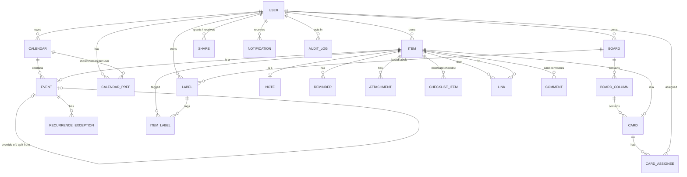
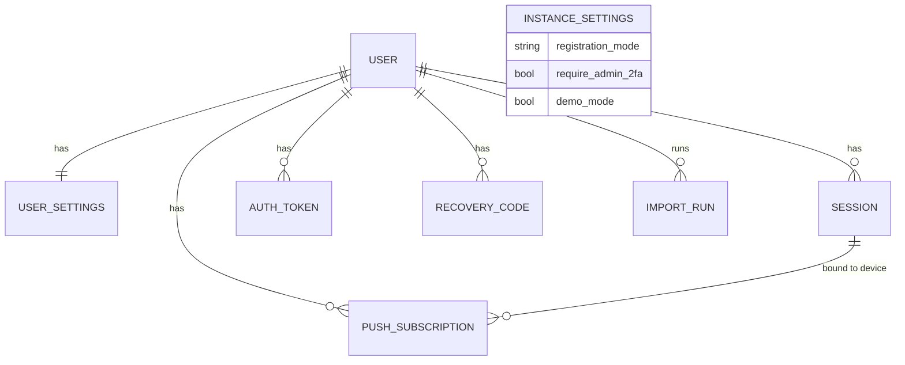

# Haalendar — Domain Model, ER Diagram and Data Dictionary

+++===+++ 2026-10-14 — Hasan Alizada — HAAL-013. v1.0 approved by owner 2026-10-14 (decisions in section 9). Based on SRS v1.3, ADR-0003 (PostgreSQL 18, SQLAlchemy), ADR-0004 (attachments), ADR-0005 (auth, sharing). 

## 1. Modelling principles
| # | Principle | Rationale / source |
|---|---|---|
| P1 | **UUIDv7 primary keys**, generated by the client or the server | Offline clients must create IDs before sync (FR-OFF-02); v7 is time-ordered → good B-tree locality; PostgreSQL 18 has native `uuidv7()`; no sequential IDs in URLs (ADR-0005) |
| P2 | **Soft delete only**: `deleted_at timestamptz NULL` on every business table; no `DELETE` privilege for the app role; no-delete triggers on every table (HAAL-030) | FR-X-01 (critical) |
| P3 | Common columns on syncable tables: `created_at`, `updated_at`, `created_by`, `updated_by`, `deleted_at`, `delete_batch_id uuid`, `version bigint`, `sync_seq bigint` | FR-X-02, FR-X-03, optimistic concurrency (SRS 4.5), sync cursor — +++===+++ 2026-10-21 — Hasan Alizada — HAAL-050. per ADR-0009: `sync_seq` from one global sequence and `sync_xid` (writing transaction) set by a trigger on every write, so a pull never skips a slow transaction. Database triggers keep `updated_at` current and `created_at` unchangeable (HAAL-031); "deleted by" = `updated_by` of a deleted row. |
| P4 | **Item supertype**: Event, Note and Card share one `item` row (class-table inheritance) | One FK target for attachments, reminders, links, labels, checklists, audit; one FTS index; unified trash, search and conversion (FR-X-04, FR-X-10, FR-INT-01/02) |
| P5 | **Containers** carry access: Calendar, Board, Note | ADR-0005 sharing model; every item stores its container for authorization and RLS |
| P6 | **Order by fractional index** (`position text`, lexicographic keys) | Concurrent offline reordering without renumbering (FR-KAN-04, FR-TODO-05) |
| P7 | **Event time = local date/time + IANA time zone**, UTC instants derived | Recurrence must keep wall-clock time across DST (RFC 5545 DTSTART;TZID); all-day events are date-only (FR-ACC-11) |
| P8 | Enumerations as PostgreSQL enums or check constraints, mirrored in contracts | Contract-first (Section V) |
| P9 | Audit log is append-only (no UPDATE/DELETE for the app role) | FR-X-03 |
| P10 | Security records (sessions, tokens) are never deleted either: `revoked_at` / `used_at` / `expires_at` markers | Consistency with P2; cleanup policy decided later with trash policy (SRS O-01) |

## 2. Enumerations
| Enum | Values |
|---|---|
| `color` | `red`, `orange`, `yellow`, `green`, `blue`, `purple`, `brown`, `black` (FR-X-13; default `brown`) |
| `priority` | `low`, `medium`, `high` (default `medium`) |
| `item_kind` | `event`, `note`, `card` |
| `container_kind` | `calendar`, `board`, `note` |
| `permission` | `view`, `edit` |
| `user_role` | `admin`, `user` |
| `exception_kind` | `cancelled`, `overridden` |
| `token_purpose` | `email_verify`, `password_reset`, `invite` |
| `notification_kind` | `reminder`, `share_received`, `share_revoked`, `sync_error`, `assigned`, `comment` |
| `audit_action` | `create`, `update`, `delete`, `restore`, `move`, `share`, `unshare`, `login`, `logout`, `admin` |
| `theme` | `system`, `light`, `dark` |
| `time_format` | `24h`, `12h` |

## 3. ER diagram — planning domain

## 4. ER diagram — accounts and platform

## 5. Data dictionary — planning domain
Legend: PK primary key, FK foreign key, NN not null, U unique. Common columns (P3) are marked **[common]** and not repeated.

### 5.1 `calendar` (container)
| Column | Type | Rules |
|---|---|---|
| id | uuid PK | |
| owner_id | uuid FK user NN | |
| name | text NN | 1..100 chars |
| color | color NN | default `blue` |
| is_default | bool NN | exactly one active default per owner (partial unique index) — FR-CAL-32 |
| archived_at | timestamptz | archived ≠ deleted |
| [common] | | |

### 5.2 `calendar_pref` (per-user view state, also for shared calendars)
| Column | Type | Rules |
|---|---|---|
| user_id | uuid FK user | PK (user_id, calendar_id) |
| calendar_id | uuid FK calendar | |
| hidden | bool NN | default false |
| updated_at | timestamptz NN | |

### 5.3 `board` (container) · `board_column`
| Table | Column | Type | Rules |
|---|---|---|---|
| board | id, owner_id | uuid | PK; FK user |
| board | name | text NN | 1..100 |
| board | position | text NN | user's board order |
| board | archived_at | timestamptz | |
| board | [common] | | |
| board_column | id | uuid PK | |
| board_column | board_id | uuid FK board NN | |
| board_column | name | text NN | 1..60 |
| board_column | position | text NN | fractional index |
| board_column | wip_limit | int | NULL = no limit, > 0 (FR-KAN-02) |
| board_column | archived_at | timestamptz | |
| board_column | [common] | | |

### 5.4 `item` (supertype of event, note, card)
| Column | Type | Rules |
|---|---|---|
| id | uuid PK | shared with subtype row (1:1) |
| kind | item_kind NN | immutable except via conversion (FR-INT-02) |
| owner_id | uuid FK user NN | creator/owner |
| container_kind | container_kind NN | `calendar` for events, `board` for cards, `note` for notes |
| container_id | uuid NN | calendar.id / board.id / item.id of the note itself; used by authz and RLS |
| title | text NN | ≤ 150 for events (FR-CAL-06); ≤ 200 others; empty event title saved as "(No title)" |
| body | text | Markdown (FR-X-20): event description, note body, card description |
| color | color NN | default from user settings (`brown`) |
| priority | priority NN | default `medium` (FR-X-12) |
| search_vector | tsvector | generated from title, body, location, checklist texts; GIN index (FR-X-10) |
| legacy_id | int | source `events.id` from legacy import (FR-OPS-01), unique per owner |
| [common] | | |

### 5.5 `event` (subtype)
<!-- +++===+++ 2026-10-22 — Hasan Alizada — HAAL-066. As built (migration 0016, D-60): the key column is `id` (= item.id) and the row carries the item's `container_kind` / `container_id` (copied like attachments) instead of `calendar_id`, so row-level security, the authz atom and the audit log treat it like other content; `recurrence_parent_id` / `split_from_id` arrive with HAAL-067 / HAAL-093. RRULE limited to the four values of calendar.recurrence.v1 by a CHECK; a series spans one day. `recurrence_exception` also carries the container columns. -->
| Column | Type | Rules |
|---|---|---|
| item_id | uuid PK FK item | |
| calendar_id | uuid FK calendar NN | = item.container_id |
| all_day | bool NN | default true (FR-CAL-06) |
| start_date | date NN | |
| start_time | time | NULL when all_day; 15-minute steps in UI |
| end_date | date NN | ≥ start_date |
| end_time | time | NULL when all_day; end datetime ≥ start datetime (FR-CAL-07) |
| tzid | text NN | IANA zone, from user profile at creation (P7) |
| start_utc / end_utc | timestamptz | derived for timed events (index for range queries); NULL for all-day |
| location | text | |
| rrule | text | RFC 5545 RRULE (FREQ, INTERVAL, BYDAY, BYMONTHDAY, BYSETPOS, UNTIL, COUNT) — FR-CAL-10/30; NULL = one-off |
| recurrence_parent_id | uuid FK event | set on a one-off created by "edit this occurrence" / "move to next day" (FR-CAL-13/20) |
| split_from_id | uuid FK event | set on the new series created by "this and following" (FR-CAL-31) |

Effective series start (FR-CAL-14) and overdue counter (FR-CAL-17) are computed from `start_date` + `rrule` + exceptions; not stored.

### 5.6 `recurrence_exception`
| Column | Type | Rules |
|---|---|---|
| id | uuid PK | |
| event_id | uuid FK event NN | the series |
| occurrence_date | date NN | U (event_id, occurrence_date) among active rows |
| kind | exception_kind NN | `cancelled` (delete this occurrence) or `overridden` |
| override_event_id | uuid FK event | required when `overridden` |
| [common] | | soft-deleting an exception = undo (FR-X-06) |

### 5.7 `note` (subtype, also its own container)
| Column | Type | Rules |
|---|---|---|
| item_id | uuid PK FK item | |
| pinned | bool NN | default false (FR-TODO-03) |
| archived_at | timestamptz | archive ≠ delete |
| position | text NN | manual order (FR-TODO-05) |
| due_at | timestamptz | optional; shown in calendar layer (FR-TODO-06) |
| is_checklist | bool NN | checklist mode (FR-TODO-02) |

### 5.8 `card` (subtype)
| Column | Type | Rules |
|---|---|---|
| item_id | uuid PK FK item | |
| board_id | uuid FK board NN | = item.container_id |
| column_id | uuid FK board_column NN | same board |
| position | text NN | order within column |
| due_at | timestamptz | badges overdue / due within 24 h (FR-KAN-08) |
| archived_at | timestamptz | |

### 5.9 `card_assignee`
| Column | Type | Rules |
|---|---|---|
| card_id | uuid FK card | PK (card_id, user_id) among active rows |
| user_id | uuid FK user | must have access to the board (ADR-0005) |
| created_at, created_by, deleted_at | | |

### 5.10 `checklist_item`
| Column | Type | Rules |
|---|---|---|
| id | uuid PK | |
| item_id | uuid FK item NN | note or card |
| text | text NN | ≤ 500 |
| checked | bool NN | |
| checked_at | timestamptz | |
| position | text NN | checked items sorted to bottom in UI (FR-TODO-02) |
| [common] | | |

### 5.11 `label` · `item_label`
| Table | Column | Type | Rules |
|---|---|---|---|
| label | id | uuid PK | |
| label | owner_id | uuid FK user NN | |
| label | board_id | uuid FK board | NULL = personal label (notes); set = board label (cards) |
| label | name | text NN | 1..40; U (owner_id, board_id, lower(name)) among active |
| label | color | color NN | |
| label | [common] | | |
| item_label | item_id, label_id | uuid FK | PK pair among active rows; created_at, created_by, deleted_at |

### 5.12 `reminder`
+++===+++ 2026-10-28 — Hasan Alizada — HAAL-091. Implemented in migration 0017 (D-79): the recipient column is `owner_id` (owner-only row-level security like the other personal tables); exactly one form (offset_minutes, or all_day_time with all_day_days_before); `next_fire_at` moved to the service table `reminder_schedule` (reminder_id, owner_id, needs_check, next_fire_at, next_occurrence, last_occurrence, last_fired_at), so the worker's bookkeeping never changes the synced, audited reminder.

| Column | Type | Rules |
|---|---|---|
| id | uuid PK | |
| item_id | uuid FK item NN | event, note or card (FR-CAL-29, FR-TODO-07, FR-KAN-07) |
| user_id | uuid FK user NN | recipient (reminders are personal, also on shared items) |
| offset_minutes | int | before start/due; for timed items |
| all_day_time | time | for all-day events: time on the day … |
| all_day_days_before | int | … N days before (0 = same day) |
| next_fire_at | timestamptz | computed; worker index; recomputed for recurring items |
| [common] | | |

### 5.13 `attachment`
| Column | Type | Rules |
|---|---|---|
| id | uuid PK | |
| item_id | uuid FK item NN | |
| container_kind, container_id | | copied from the item (row-level security and audit like the item; D-45, 2026-10-17) |
| uploaded_by | uuid FK user NN | |
| file_name | text NN | original name, sanitised |
| media_type | text NN | image/png, image/jpeg, image/webp, image/gif — verified by content (FR-X-11) |
| size_bytes | int NN | ≤ 10 MB |
| width, height | int | |
| content_hash | text NN | BLAKE3 hex; storage key = per-user prefix + hash (ADR-0004) |
| storage_key | text NN | adapter-specific key |
| thumbnail_key | text NN | WebP thumbnail ≤ 320 px, made at upload (D-45) |
| [common] | | binary never deleted (P2) |

### 5.14 `link`
| Column | Type | Rules |
|---|---|---|
| id | uuid PK | |
| from_item_id | uuid FK item NN | |
| to_item_id | uuid FK item NN | ≠ from; U unordered pair among active |
| origin | text | `manual`, `time_block` (FR-INT-04), `conversion` (FR-INT-02) |
| [common] | | |

### 5.15 `comment`
| Column | Type | Rules |
|---|---|---|
| id | uuid PK | |
| item_id | uuid FK item NN | cards in v1.0 (FR-KAN-05) |
| author_id | uuid FK user NN | |
| body | text NN | Markdown |
| [common] | | |

### 5.16 `share`
| Column | Type | Rules |
|---|---|---|
| id | uuid PK | |
| container_kind | container_kind NN | |
| container_id | uuid NN | |
| grantee_id | uuid FK user NN | ≠ owner; U (container, grantee) among non-revoked |
| permission | permission NN | |
| granted_by | uuid FK user NN | owner only (ADR-0005) |
| created_at, updated_at, revoked_at | timestamptz | revocation is soft |
| version, sync_seq | bigint | |

### 5.17 `notification`
+++===+++ 2026-10-19 — Hasan Alizada — HAAL-048. Implemented in migration 0013 (D-52): the user column is `owner_id` (owner-only row-level security as for the other per-user tables); kind adds `export_ready`; rows for other users come from the share trigger; only read_at / delivered_push_at may change; never deleted.

| Column | Type | Rules |
|---|---|---|
| id | uuid PK | uuidv7() |
| owner_id | uuid FK user NN | |
| kind | notification_kind NN | reminder, share_received, share_revoked, sync_error, assigned, comment, export_ready |
| item_id | uuid FK item | optional |
| payload | jsonb NN | display data |
| created_at | timestamptz NN | |
| read_at | timestamptz | FR-X-21 |
| delivered_push_at | timestamptz | Web Push delivery |

### 5.17a `sync_mutation` (service data)
+++===+++ 2026-10-21 — Hasan Alizada — HAAL-050. ADR-0009: exactly-once application of offline mutations. Kept (service data under the owner rule; any clean-up would be a separate, explicitly listed exception). Implemented in HAAL-053 (migration 0014, with the global sequence `sync_seq_global`, the stamp trigger on calendar / share / item / attachment / user_settings and `haalendar_sync_high_water()`).

| Column | Type | Rules |
|---|---|---|
| mutation_id | uuid PK | client-generated UUIDv7 |
| owner_id | uuid FK user NN | owner-only row-level security |
| applied_at | timestamptz NN | |
| status | text NN | applied, conflict, rejected |
| result | jsonb NN | stored answer returned for a duplicate |

Conflict records (both values of a field changed on two devices) live on the device next to the outbox (Dexie), not on the server; they become notifications in the `sync_error` channel (HAAL-048, HAAL-054).

### 5.18 `audit_log` (append-only)
+++===+++ 2026-10-16 — Hasan Alizada — HAAL-032. Implemented in migration 0009: rows written by database triggers (D-37); `entity_id` of one-row tables is the nil UUID.

| Column | Type | Rules |
|---|---|---|
| id | uuid PK | |
| occurred_at | timestamptz NN | |
| actor_id | uuid FK user | NULL for system/worker |
| action | audit_action NN | |
| entity_type | text NN | table name |
| entity_id | uuid NN | |
| container_kind, container_id | | for per-container history and access checks |
| before, after | jsonb | snapshots (FR-X-03); no secrets |
| request_id | text | correlation id (observability) |
| Indexes | | (entity_type, entity_id, occurred_at); (actor_id, occurred_at) |

## 6. Data dictionary — accounts and platform
| Table | Key columns | Rules |
|---|---|---|
| `user_account` (table name; `user` is reserved in PostgreSQL) | id, email (U on lower(email)), email_verified_at, password_hash, display_name, avatar_key, time_zone (IANA), locale, role, totp_secret_enc, totp_enabled_at, failed_login_count, locked_until, last_login_at, deactivated_at, must_change_password, [common] | Argon2id hash; TOTP secret encrypted with server key; soft deactivation (ADR-0005) |
| `user_settings` | owner_id PK (FK user_account), week_start (0..6, default 1 = Monday), time_format (`24h`/`12h`), theme (`system`/`light`/`dark`), default_color (default `brown`), agenda_days (1..365, default 30), week_ab_enabled, week_ab_anchor (date: any day of a week labelled first; required while enabled), week_ab_labels (text[2], default {A,B}, different), created_at, updated_at, version, sync_seq | FR-ACC-09, FR-CAL-23/27; owner-only RLS, no delete, not audited (D-50, HAAL-045) |
| `session` | id, token_hash (U), user_id, created_at, last_seen_at, idle_expires_at, absolute_expires_at, revoked_at, user_agent, ip_prefix, csrf_secret, reauth_at | idle 30 d, absolute 90 d; re-auth window 15 min (ADR-0005) |
| `auth_token` | id, user_id (NULL for invite to new e-mail), email, purpose, token_hash (U), expires_at, used_at, created_by | verify 24 h, reset 1 h, invite |
| `recovery_code` | id, user_id, code_hash, used_at, created_at | 10 per TOTP enrolment |
| `push_subscription` | id, user_id, session_id, endpoint (U), p256dh, auth, created_at, revoked_at | Web Push (FR-CAL-29) |

+++===+++ 2026-10-28 — Hasan Alizada — HAAL-091 (migration 0018, D-79): `push_subscription` has owner_id (owner-only row-level security), user_agent, last_sent_at and revoke_reason (user, sign_out, gone, claimed) instead of a session link — the browser revokes it at sign-out, and an endpoint taken over by another user on the same browser is revoked for the previous one; unique per user and endpoint while active. `push_key`: the instance's VAPID key pair, one row, private key encrypted.
| `instance_settings` | single row: registration_mode (`invite`/`open`), require_admin_2fa, demo_mode, smtp_configured, updated_at, updated_by | |
| `import_run` | id, user_id (target), started_by, started_at, finished_at, dry_run, source_hash, report jsonb | FR-OPS-01 |

## 7. Integrity and index rules (summary)
- Uniqueness "among active rows" = partial unique index `WHERE deleted_at IS NULL` (or `revoked_at IS NULL`).
- Every FK to a soft-deletable parent stays valid; children are hidden through the parent's `deleted_at`, not cascaded physically. Restore of a parent restores visibility of children deleted together with it (same `delete_batch_id`; children deleted earlier in a separate operation stay deleted).
- Indexes: `item(container_kind, container_id) WHERE deleted_at IS NULL`; `item USING gin(search_vector)`; `event(calendar_id, start_date, end_date)`; `event(start_utc)`; `card(column_id, position)`; `reminder(next_fire_at) WHERE deleted_at IS NULL`; `sync_seq` per syncable table.
- RLS policies (ADR-0005) on tables with `owner_id` / `container_*`: visible if owner = current user or an active share exists for the container.

## 8. Legacy mapping (FR-OPS-01)
| Legacy | New |
|---|---|
| `events.id` | `item.legacy_id` |
| `title` / `description` / `location` | `item.title` / `item.body` / `event.location` |
| `datefrom`, `timefrom`, `dateto`, `timeto`, `allday` | `event.start_date`, `start_time`, `end_date`, `end_time`, `all_day`; `tzid` = target user's time zone |
| `color` (0..7) | `item.color` (red…black) |
| `daily/weekly/monthly/annually` | `event.rrule` = `FREQ=DAILY/WEEKLY/MONTHLY/YEARLY` |
| `exclusions(event_id, dt)` | `recurrence_exception(kind = cancelled)` |
| `deleted = 1` | `item.deleted_at` = import time (D-17) |
| `create_ts`, `last_update_ts` (`m/d/Y H:i:s TZ`) | `created_at`, `updated_at` |
| `log` | `audit_log` (action from message, `before/after` from data JSON when present) |
| — | all events go to the target user's default calendar |

## 9. Owner decisions (2026-10-14)
1. Item supertype: one `item` table for events, notes and cards.
2. Event time stored as local date/time + IANA time zone; UTC instant derived (SRS FR-ACC-11 refined).
3. `delete_batch_id` on every soft-deletable table; restore of a container restores exactly the children deleted with it.
4. Default colors: calendar `blue`, event `brown`.
