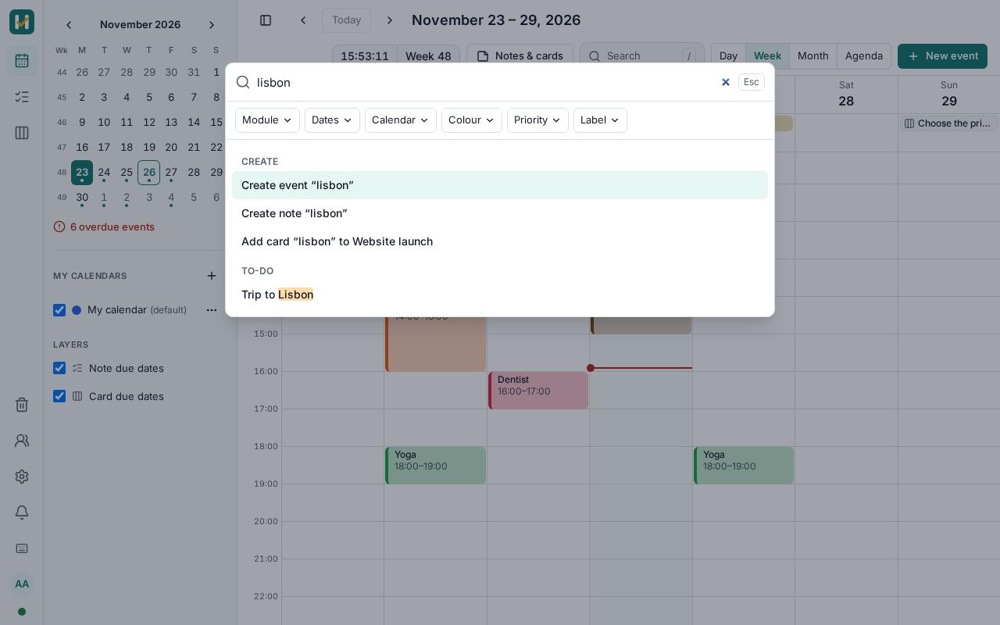
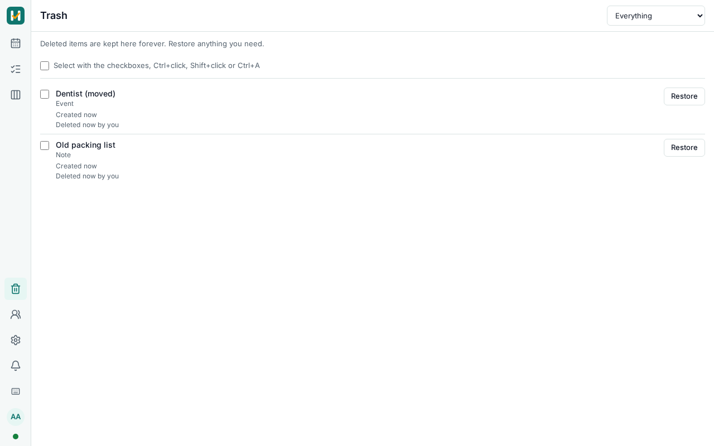

# Across the app

+++===+++ 2026-11-26 — Hasan Alizada — HAAL-153 (D-129, stage 2). What works the same in the calendar, To-Do and Kanban.

## Search and commands

**Search** at the top, or `/`, searches events, notes and cards: titles, places, descriptions, checklists and comments,
also without a connection. The results come in groups by module, with the words found marked. Filters narrow them by
module, dates (today, this week, this month, the next 30 days or your own), calendar, colour, priority and label; with
filters alone, without words, it lists everything that matches them. A date typed as `2027-06-16` opens that day.

`Ctrl+K` (`⌘K` on a Mac) opens the same window with **commands** on top: go to a page, a board or today, create an
event, a note, a list or a card — with the words you typed as its title.

## Links

**Links** in an event, a note or a card connect it with others: **Add link…** finds them by their title, and both show
the link. A linked item in the trash or one you cannot open is marked as such. Up to 50 links per item.

## Converting

**Convert to…** makes an event a note or a card, a note an event or a card, a card an event or a note — the same item,
with its title, description, colour, priority, images, links and history. Before converting it says what changes:
for example a checklist becomes a list in the description, an event without a time is all day, labels, assignees and
comments of a card are taken off. A repeating event cannot be converted. Undo brings everything back.

## Images

Events, notes and cards can hold images (PNG, JPEG, WebP or GIF, up to 10 MB each): **Add image**, drop them on the
editor, or paste a screenshot. Click one to see it large and to go through the others. Adding images needs a
connection, and the item must have reached the server.

## Formatting

Descriptions, notes and comments understand **Markdown**: `**bold**`, `*italic*`, `~~struck~~`, `` `code` ``, links,
headings, lists, task lists, quotes, code blocks and tables. **Preview** shows the result, **Formatting help** all of it
with a place to try. HTML is shown as text; links open in a new tab, and only web, e-mail and phone links work.

## Sharing

Calendars, boards and notes can be shared with other people of the same installation: **Share…** in their menu, their
e-mail address, and **Can view** or **Can edit**. Editors change the contents, but cannot rename, delete or share it.
They are told in their notifications, and can **Leave**. **Settings → Sharing** lists what you shared and what others
shared with you; changing or removing access works from there too. Reminders and labels stay personal on shared items.

## Selecting many

In the calendar's day list, on a board and in the trash: select with the check boxes, `Ctrl`+click, `Shift`+click,
`Ctrl+A`, or with the keyboard (`Space` on the focused row, `Shift` with the arrows); on a phone press and hold. The bar
that appears changes the colour or the priority, moves events to the next day, deletes, or in the trash restores.
If one of them was changed elsewhere meanwhile, nothing is changed and the list is refreshed.

## Undo and the trash

Most changes show a message with **Undo**; `Ctrl+Z` undoes the last ones and `Ctrl+Shift+Z` or `Ctrl+Y` redoes them,
as long as nobody changed the same thing meanwhile.

Nothing is deleted for good. **Trash** keeps whatever was deleted — events, notes, cards, calendars, boards, columns,
images, comments — and **Restore** brings it back, with what was deleted together with it. An item whose calendar or
board is in the trash too asks to restore both.

## History and notifications

**Activity** in the editor of an event, a note or a card shows who changed what and when: created, changed fields, moved, deleted,
restored, shared, checklist items, images, links and assignees.

The **bell** collects what concerns you: reminders, sharing, assignments, comments on cards assigned to you, a finished data
export. **Mark all read** clears the count.
