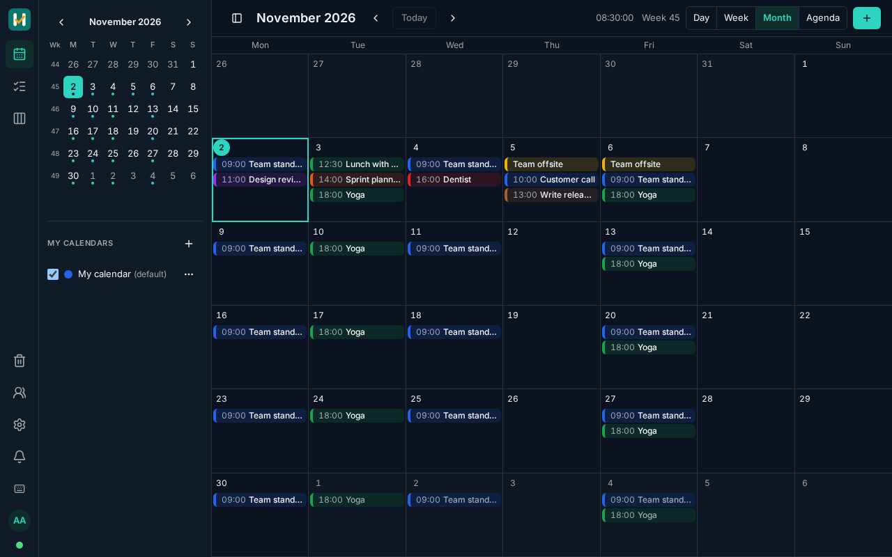
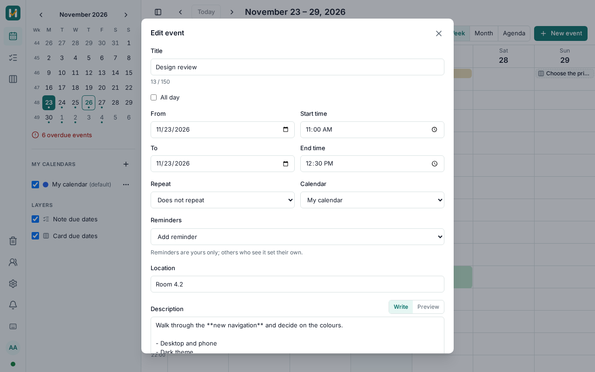
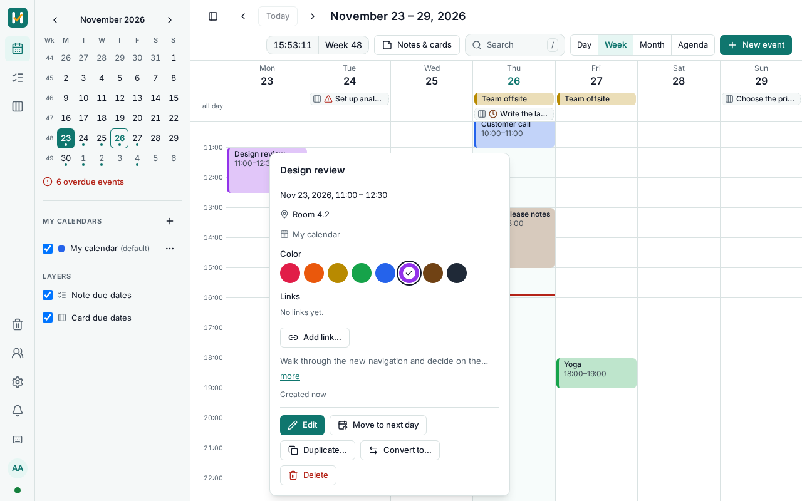

# Calendar

+++===+++ 2026-11-26 — Hasan Alizada — HAAL-153 (D-129, stage 2).

## Views

**Day**, **Week**, **Month** and **Agenda** at the top (keys `D`, `W`, `M`, `A`); the arrows or `←` `→` move by
one day, week, month or range, **Today** (`T`) comes back. The day shows its events as a list, or as **Hours** with
**Day as**; the agenda lists the coming days (how many: [Settings](settings.md#preferences)). The address in the browser
keeps the view and the date, so a bookmark opens the same page.

The sidebar (it can be hidden) has a small month with ISO week numbers to jump to any date, the number of **overdue
events** (one-off events of past days and repeating series that began before today; it is hidden at zero), your
calendars and the **layers**. The header shows the time, the ISO week number, the day of the year and, if you turned
it on, the Week A/B label of the week ([Settings](settings.md#preferences)).

## Events

**New event** (`N`, or from the command palette). An event has:

- a **title** (up to 150 characters) — when another event already has it, the app asks before saving and shows them;
- **all day**, or a start and an end time; it may last several days;
- **repeat** ([below](#repeating-events)), the **calendar**, **reminders** ([below](#reminders)), the **location**;
- a **description** with formatting ([Across the app](across-the-app.md#formatting)), images, the **colour** and the
  **priority**.

Times are in the time zone of your profile; an event made in another zone keeps it, and the editor says so.

Clicking an event opens its **details**: the time, place, calendar, colour (changed right there), links, the start of
the description (**more** shows all), when it was created and changed, and the actions **Edit** (`E`), **Move to next
day**, **Duplicate…** (`D`, a copy with its details and images on the date you choose), **Convert to…** a note or a
card, and **Delete** (`Del`).

**Moving:** drag an event to another day or time with the mouse, or hold it with a finger and drag; `Esc` cancels.

**Several at once:** in the day's list, select events with their check boxes, `Ctrl`+click, `Shift`+click or
`Ctrl+A` (on a phone: press and hold), then change their colour or priority, move them to the next day or delete them
([Across the app](across-the-app.md#selecting-many)).

## Repeating events

**Repeat** offers every day, week, month or year, and **Custom…**: every N days, weeks (on chosen days of the week),
months (on the same day, the same weekday such as the second Tuesday, or the last day) or years, ending never, on a
date or after a number of occurrences. A repeating event lasts one day at most.

Changing, moving or deleting one occurrence asks what you mean:

| Choice | What happens |
|---|---|
| Only this occurrence | It becomes a separate event on its own date; the series skips that date |
| This and following | The series ends the day before; the rest becomes a new series with your change (or is deleted) |
| All occurrences | The whole series changes (or goes to the trash) |

A skipped or changed date can come back: undo, or restore it from the trash.

## Reminders

**Reminders** in the editor: at the start, minutes, hours, days or weeks before, or **Custom…**; for an all-day event,
on the day or some days before at a time you choose. Up to five. Reminders are yours alone: others who see a shared
event set their own.

A reminder appears in the app's notifications (the bell) and, if you turned them on, as a notification of the browser
even while Haalendar is closed ([Settings](settings.md#notifications)). One that could not be sent on time (the server
was off) comes late and says so.

## Calendars

Everyone starts with **My calendar**; **New calendar** in the sidebar adds more. Each calendar's menu (`…`) has **Edit
name and color…**, **Share…**, **Make default** (new events go there), **Archive** (it is kept, read-only, under
**Archived**), **Delete…** (with its events, to the trash; the default calendar cannot be deleted), **Import .ics…** and
**Export .ics**. The check box shows or hides a calendar.

**Shared with me** lists calendars others shared with you, read-only or editable; **Leave** removes one from your list.
Sharing: [Across the app](across-the-app.md#sharing).

**Import .ics…** adds the events of an iCalendar file (from Google Calendar, Outlook, Apple Calendar and others, up to
5 MB) to the calendar; importing the same file again skips the events already there, and what cannot be imported is
listed with the reason. The whole import can be undone. **Export .ics** downloads the calendar for another app.

## Notes and cards in the calendar

**Layers** in the sidebar show the due dates of your notes and of your cards on the days they are due; clicking one
opens it. **Notes & cards** at the top opens a list of notes and cards to plan: drag one onto the week or the day
(or use **Schedule…**) to make an event for it, linked to it.
