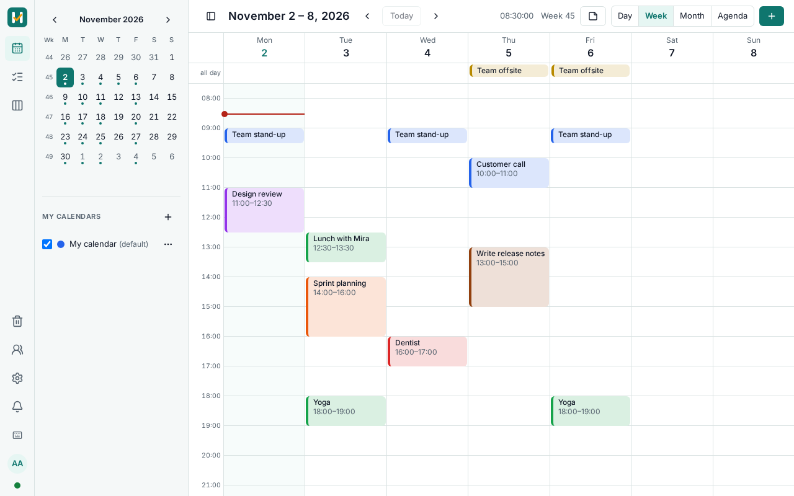

# Getting started

+++===+++ 2026-11-26 — Hasan Alizada — HAAL-153 (D-129, stage 2).

## Signing in

- **Invited by e-mail:** open the link of the invitation (valid 7 days), choose your name and a password, and you are
  in. Without e-mail on the installation, the administrator gives you a one-time password instead; the app asks for
  a new password at the first sign-in.
- **Open sign-up**, if the installation allows it: **Create an account** on the sign-in page, then confirm your address
  with the link that is e-mailed to you.
- **Password:** at least 15 characters; a sentence of a few words works well. Common and leaked passwords are refused.
- **Forgotten password:** **Forgot password?** on the sign-in page e-mails a link valid for one hour. It also ends a
  lock after too many wrong passwords.
- **Two-factor sign-in**, once you turned it on ([Settings](settings.md#security)): after the password, the 6-digit
  code of your authenticator app, or one of your recovery codes.

A sign-in lasts 30 days from the last use, at most 90 days (the installation may set other numbers). Five wrong passwords in a row lock the account for 15
minutes, longer after each further five; it is never locked for good.

## The screen

On a computer the bar on the left leads to **Calendar** (`Alt+1`), **To-Do** (`Alt+2`) and **Kanban** (`Alt+3`); below
them **Trash**, **Settings**, the **notifications** bell, the **keyboard shortcuts**, and your picture, which opens
the account menu (profile, settings, export of your data, sync, help, about, sign out). Administrators also see
**Users**. The dot under your picture is the connection: green when connected, and it says when changes wait to be sent.
On a phone the same items are in the menu at the top left.

Everything changes in place and is saved at once; a message at the bottom says what was done, most of the time with
**Undo** ([Across the app](across-the-app.md#undo-and-the-trash)).

Your time zone is in your profile. When the device is set to another one, the app asks which to use; times are always
shown in the one of your profile.

## The app on your device

Haalendar can be installed like an app: **Install app** in the account menu (Chrome and Edge on a computer or Android),
or on an iPhone or iPad Safari's Share → **Add to Home Screen**. It then opens in its own window, and from the start
screen.

After the first sign-in the app works **without a connection**: your calendars, notes and boards are kept on the
device, and what you change is sent as soon as the connection is back. Settings, sharing and images need the
connection. More in [Sync and conflicts](sync.md).

When a new version of Haalendar is installed on the server, the app says so: **Reload** to use it.

## Signing out

**Sign out** in the account menu removes your data from this device. If changes have not reached the server yet
(no connection), it says so first, as signing out would delete them.
