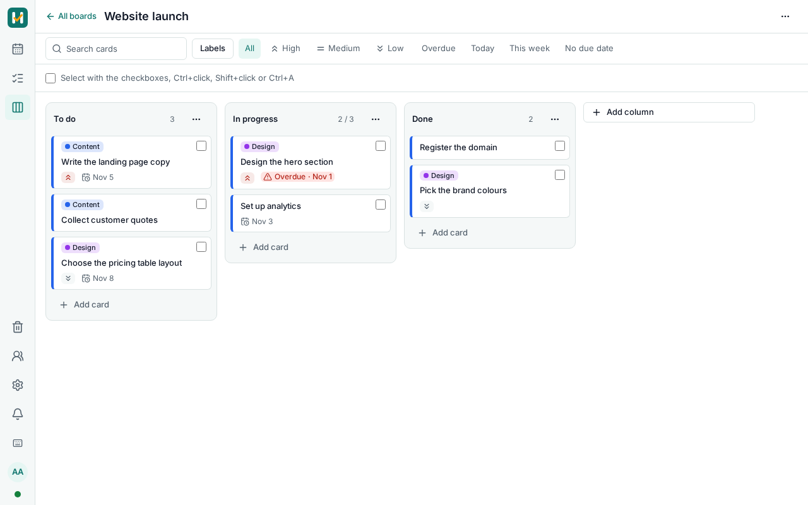
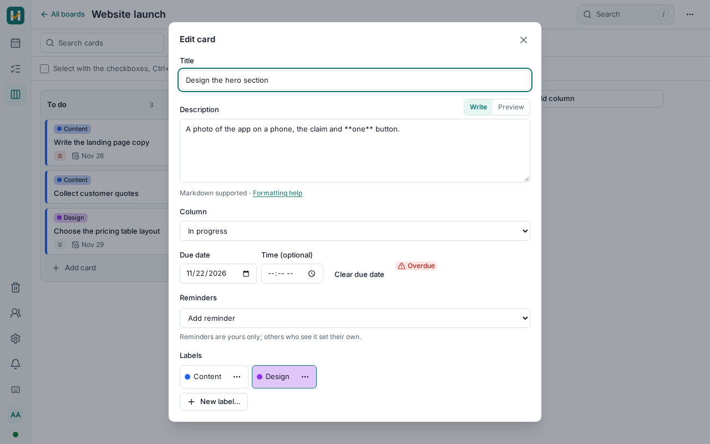

# Kanban

+++===+++ 2026-11-26 — Hasan Alizada — HAAL-153 (D-129, stage 2).

## Boards

**Kanban** lists **My boards**, **Shared with me** and the **Archived** ones. **New board** starts one with the columns
To do, In progress and Done. A board's menu has **Rename…**, **Share…**, **Archive** (it is kept, read-only),
**Delete…** (with its cards, to the trash) and, on a board shared with you, **Leave**. People you share a board with
for editing can change its columns and cards, but not rename, delete or share the board.

## Columns

**Add column** at the right end. A column's menu renames it, moves it left or right, archives or deletes it, and sets
a **WIP limit…**: how many cards it should hold at most (1 to 999). Going over the limit is marked, never refused.
Archived columns come back from **Archived columns…** in the board's menu.

## Cards

**Add card** under a column: type the title, `Enter`. Click a card to open it: the title, a description with
formatting, the column, a due date with an optional time, reminders (counted from the due date), labels, assignees,
the colour, the priority, images, links, a checklist and its **Activity**.

- **Moving:** drag a card to another place or column (on a phone: hold it, then drag), or focus it and press `Alt`
  with the arrow keys.
- **Due dates** show on the card, marked **Due soon** or **Overdue**, and on the calendar's layer **Card due dates**.
- **Labels** belong to the board: **New label…** in the card, or rename, recolour and delete them from a label's menu.
- **Assignees** are people of the board (its owner and those it is shared with). Assigning someone else tells them in
  their notifications.
- **Comments** are under **Activity**, with the history of the card (**Comments only** hides the history).
  `Ctrl+Enter` sends one; you can change or delete your own, and the board's owner can delete any. A new comment tells
  the people assigned to the card.

## Finding cards

**Filters** at the top of a board: words of the title or description, labels, assignees (**Me** for your own), and the
due date (overdue, today, this week, none). The number of cards shown is next to them; **Clear filters** shows all.
The dots below a phone's board jump to a column.

Several cards at once: [Across the app](across-the-app.md#selecting-many).
