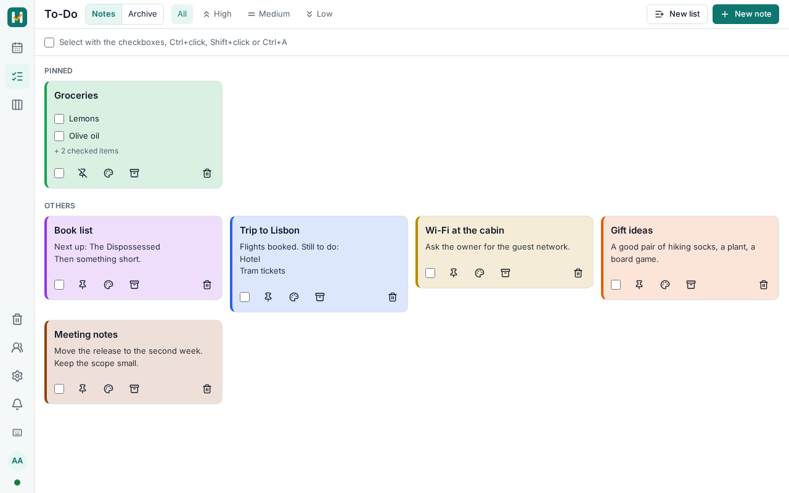

# To-Do

+++===+++ 2026-11-26 — Hasan Alizada — HAAL-153 (D-129, stage 2).

## Notes

**New note** opens the editor: a title, the text with formatting ([Across the app](across-the-app.md#formatting)),
the colour, the priority, a due date, reminders, labels and images. **New list** starts a note as a checklist. A note
is saved once it has a title or some text.

On each note: **Pin** keeps it on top under **Pinned**; **Archive** moves it to the **Archive** tab (it is not
deleted, and stays editable); the colour; **Delete** (to the trash). Notes others shared with you are under **Shared
with me**, marked whether you can edit or only view them.

**Grid** or **List** at the top changes the layout. The order is yours: drag a note to another place, or focus it and
press `Alt` with the arrow keys; the order is the same on all your devices. The priority filter and **Labels** show
only some of the notes.

## Checklists

**Add checklist** in the editor (or **New list**) turns the text into items: check them off, rename them, drag them
or move them with `Alt+↑` and `Alt+↓`. Checked items move to the bottom under **Checked**. A checklist holds up to 200
items; the note in the list shows the first ones and how many are done. **Remove checklist** turns it back.

## Due dates and reminders

A note may have a **due date**, with an optional time. Notes with a due date show it, marked overdue or due soon, and
appear on the calendar's layer **Note due dates** ([Calendar](calendar.md#notes-and-cards-in-the-calendar)).

**Reminders** of a note are a date and a time of your choice, each fired once, up to five per note.

## Labels

Labels group notes: the **Labels:** line in the editor puts them on a note, **Manage labels…** creates, renames,
recolours and deletes them. Your labels are yours alone: nobody else sees them, also on notes shared with you. Up to
100 labels, up to 20 on one note.

## Sharing a note

**Share…** in the editor of your note gives other people of the installation access to it, to view or to edit
([Across the app](across-the-app.md#sharing)).
